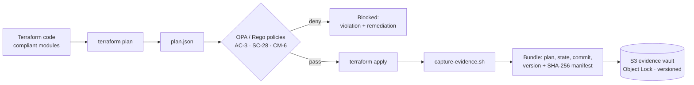

# cgep-labs — Compliance as Code for AWS and GCP

Infrastructure that is **compliant by default, checked by policy, and backed by tamper-proof evidence.**

This repo turns NIST SP 800-53 controls into working code across three layers:

1. **Prevent:** Terraform modules that can only create storage in a compliant configuration.
2. **Detect:** Open Policy Agent (Rego) policies that reject non-compliant Terraform plans before they are applied, with unit tests that prove each rule fires.
3. **Prove:** An evidence pipeline that hashes plan, state and commit artifacts and stores them in a write-once (S3 Object Lock) vault for auditors.

Every resource, policy and test is mapped to the control it satisfies, so an auditor can trace a requirement from the control ID all the way to the line of code and the test result that proves it.

---

## Architecture



---

## Control mapping

| Control | Name | Enforced by (prevent) | Checked by (detect) | Proven by (test / evidence) |
|---|---|---|---|---|
| **AC-3** | Access Enforcement | S3 public access block on all buckets; GCS `uniform_bucket_level_access` + `public_access_prevention = "enforced"` | `policies/ac3_no_public.rego`, which also blocks firewall rules opening SSH (22) / RDP (3389) to `0.0.0.0/0` | `test_locked_bucket_passes`, `test_public_bucket_fails`, `test_open_ssh_fails` |
| **SC-28** | Protection of Information at Rest | S3 default encryption (AES-256); GCS customer-managed KMS key (CMEK) | `policies/sc28_encryption.rego` (GCS buckets must use CMEK) | `test_cmek_passes`, `test_no_cmek_fails` |
| **SC-12 / SC-13** | Key Establishment / Cryptographic Protection | Dedicated Cloud KMS key ring and key per bucket, 90-day rotation, least-privilege grant to the GCS service agent | — | `evidence/lab-2-4/attestation.json` |
| **CM-6** | Configuration Settings | AWS `default_tags`; GCS required labels merged into every bucket; input validation on names and environments | `policies/cm6_required_tags.rego` | `test_complete_passes`, `test_partial_fails`, `test_no_labels_fail` |
| **AU-3 / AU-6** | Audit Record Content / Review | S3 server access logging to a dedicated, encrypted, non-public log bucket | — | `evidence/lab-2-3/plan.json` |
| **AU-9** | Protection of Audit Information | Evidence vault with S3 Object Lock, versioning, and a bucket policy denying deletion by anyone but the account root | — | Object version ID returned by `capture-evidence.sh` |
| **AU-11** | Audit Record Retention | GCS retention policy; Terraform validation **refuses prod buckets with < 365 days** retention | — | `variables.tf` validation rules |

---

## Repository layout

```
.
├── terraform/
│   ├── modules/
│   │   └── compliant-gcs-bucket/   # Reusable GCS module: CMEK, retention, labels, no public access
│   └── primitives/
│       ├── compliant-s3/           # S3 data bucket + access-log bucket
│       ├── compliant-gcs*/         # Consumers of the GCS module (dev / prod)
│       ├── evidence-vault/         # Write-once S3 vault (Object Lock)
│       └── policy-fixture/         # Intentionally mixed resources for policy testing
├── policies/
│   ├── ac3_no_public.rego
│   ├── sc28_encryption.rego
│   ├── cm6_required_tags.rego
│   └── tests/                      # OPA unit tests, pass and fail cases for each policy
├── scripts/
│   └── capture-evidence.sh         # Bundles, hashes and uploads audit evidence
└── evidence/                       # Sample outputs: plans, attestations, test results
```

---

## Design decisions

- **Prevention over detection.** The modules make the compliant configuration the only configuration. Policies are a second line of defense for code that doesn't use the modules.
- **Every violation explains its fix.** Each Rego rule carries metadata (`control_id`, `framework`, `severity`, `remediation`), and every deny message names the control and the remediation, so a developer can fix it without opening a ticket.
- **Policies are tested like code.** Each policy has passing and failing test cases. A rule that never fires is as dangerous as a missing rule.
- **Evidence must be tamper-evident.** Bundles include a SHA-256 manifest and capture timestamp, and land in an Object Lock bucket. `GOVERNANCE` mode is used for lab work; `COMPLIANCE` mode is the production setting, where not even the root user can delete evidence before retention expires.
- **Validation at plan time.** Bad inputs (wrong environment name, prod with short retention) fail at `terraform plan`, before anything reaches the cloud.

---

## How to run

### Prerequisites

- Terraform >= 1.6
- [OPA](https://www.openpolicyagent.org/docs/latest/#running-opa) (or [Conftest](https://www.conftest.dev/))
- AWS CLI and/or `gcloud`, authenticated to a sandbox account

### 1. Run the policy tests

```bash
opa test policies/ -v
```

### 2. Check a Terraform plan against the policies

```bash
cd terraform/primitives/compliant-gcs
terraform init
terraform plan -out tfplan
terraform show -json tfplan > plan.json

opa eval -d ../../../policies -i plan.json "data.compliance[_].deny" --format pretty
```

An empty result means the plan is compliant. Any output lists the violated control and how to fix it.

### 3. Capture evidence to the vault

```bash
# Deploy the vault once
cd terraform/primitives/evidence-vault && terraform init && terraform apply

# Capture evidence for a workspace
./scripts/capture-evidence.sh \
  --workspace terraform/primitives/compliant-s3 \
  --run-id "$(date -u +%Y%m%d-%H%M%S)" \
  --vault <vault-bucket-name>
```

The script prints a JSON receipt with the S3 key and object version ID, which can be referenced in an audit ticket.

---

## Roadmap

- [ ] **CI policy gate:** GitHub Actions workflow running `terraform plan` → OPA on every pull request, failing the build on any violation and uploading evidence on merge.
- [ ] **IAM drift detection (AC-2 / AC-6):** Compare live IAM policies and CloudTrail activity against a Git baseline; flag over-privileged and unowned non-human identities, and store the drift report as evidence.
- [ ] Extend SC-28 policy to S3 and require KMS (SSE-KMS) instead of SSE-S3.
- [ ] Map controls to SOC 2 (CC6.1, CC7.2) and ISO 27001 Annex A alongside NIST 800-53.

---

## About

Built by [@skhan847](https://github.com/skhan847), a DevSecOps and AI governance engineer (AIGP bootcamp), as part of GRC engineering coursework and extended into a working compliance-as-code pipeline. Feedback and issues welcome.
